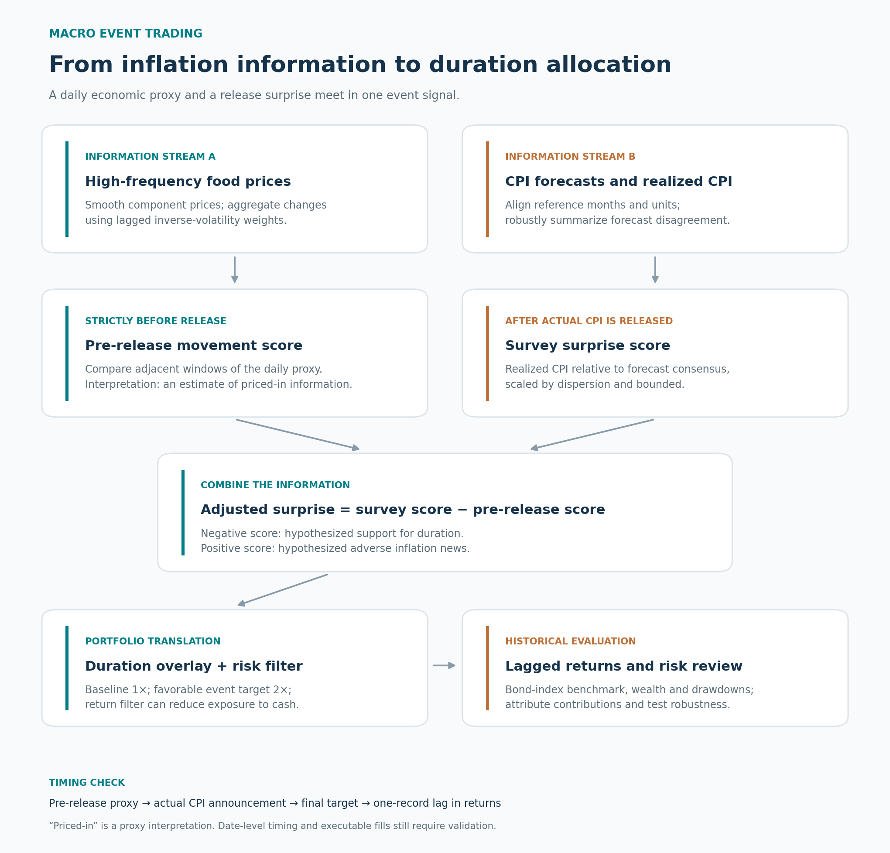
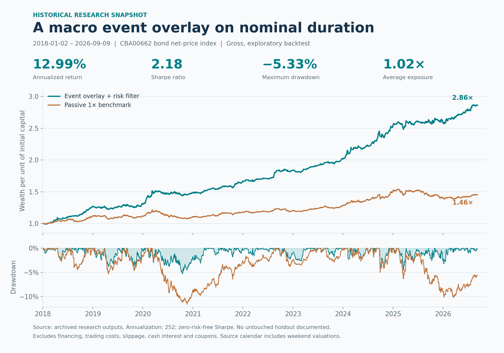

# Macro Event Trading

### Inflation surprises, information already priced in, and systematic duration allocation

**Research portfolio by Chenyu Li · Systematic macro / fixed income · China CPI case study**

An event-driven research framework that asks: **does a macro release still contain useful information after accounting for the inflation trend visible before the announcement?**

I combine a daily inflation proxy built from high-frequency food prices with survey-based CPI surprises, then evaluate the resulting signal as a duration overlay on a long-dated Chinese government bond price index.

> **Public research presentation.** This repository shares the economic idea, workflow, aggregate results, and research discussion. Implementation code, notebooks, raw datasets, and event-level trading signals are kept private. Results below are exploratory historical backtests.

[Research methodology](docs/methodology.md) · [Results and assumptions](docs/results.md) · [Interview walkthrough](docs/interview_guide.md) · [中文导读](docs/README_CN.md)

## Research question

A CPI release can beat economists' forecasts even after inflation-sensitive prices have already moved. The headline forecast error and the information that remains unanticipated need not be the same.

The working hypothesis is that a **survey surprise adjusted for a pre-release inflation proxy** can help distinguish inflation news that is relatively adverse or supportive for nominal duration. The adjustment is a modeling hypothesis: food-price movements do not directly observe investor expectations or positioning.

## Workflow

[Vector workflow](assets/research_workflow.svg)

| Stage | Research decision | Output |
| --- | --- | --- |
| Daily inflation proxy | Smooth a food-price basket and aggregate changes using lagged inverse-volatility weights | A daily factor-mimicking index |
| Survey surprise | Compare realized CPI with the cleaned cross-section of forecasts | A standardized announcement surprise |
| Pre-release adjustment | Score changes in the inflation proxy using observations strictly before release | An estimate of information already reflected in the proxy |
| Event allocation | Subtract the adjustment; translate the score into a duration overlay and apply a return-based risk filter | Lagged exposure to the bond index |
| Evaluation | Compare compounded returns, drawdowns, and calendar-year outcomes with a passive benchmark | A research backtest with explicit assumptions |

The complete score uses the realized CPI release and is therefore available **after announcement**. The historical engine applies target exposure with a one-record lag; release timestamps and implementable execution prices require additional validation.

## Historical result snapshot

**2018-01-02 to 2026-09-09 · CBA00662 bond net-price index · Gross returns**

| Metric | Event overlay + risk filter | Passive 1× benchmark |
| --- | ---: | ---: |
| Annualized compounded return | **12.99%** | 4.45% |
| Sharpe ratio | **2.18** | 0.93 |
| Calmar ratio | **2.44** | 0.38 |
| Maximum drawdown | **−5.33%** | −11.60% |
| Cumulative return | **186.38%** | 45.53% |

The reported configuration combines a macro event overlay with a separate return filter. These results do **not** isolate the macro signal's contribution. A favorable event raises baseline 1× exposure to 2× for a fixed window; the risk filter can reduce exposure to cash. Average realized exposure in this sample was approximately 1.02×, which does not by itself establish risk-matched outperformance.

**Interpretation:** this is an exploratory result, with no separately documented untouched holdout. Financing, trading costs, slippage, cash interest, and coupon income are excluded. The source index has 60 weekend valuation records; the 20-record holding window is not exactly 20 exchange trading days. See [full assumptions and limitations](docs/results.md) before interpreting the figures.

## What this project demonstrates

- Translating a macroeconomic hypothesis into a measurable event signal.
- Combining high-frequency price information with low-frequency economic releases.
- Aligning forecast reference months, publication dates, and pre-release information sets.
- Separating signal construction, portfolio exposure, and risk control.
- Checking return alignment and recognizing the difference between a historical result and evidence of deployable alpha.

## Reading path

| For a reviewer with… | Start here |
| --- | --- |
| One minute | Research question, workflow, and headline results above |
| Five minutes | [Methodology](docs/methodology.md) and [result interpretation](docs/results.md) |
| A technical interview | [Pitch, design choices, and likely follow-up questions](docs/interview_guide.md) |
| A preference for Chinese | [中文研究说明与面试提纲](docs/README_CN.md) |

Aggregate result tables are in [results](results). No public executable reproduction package is provided. Public materials prepared on 2026-11-14.
