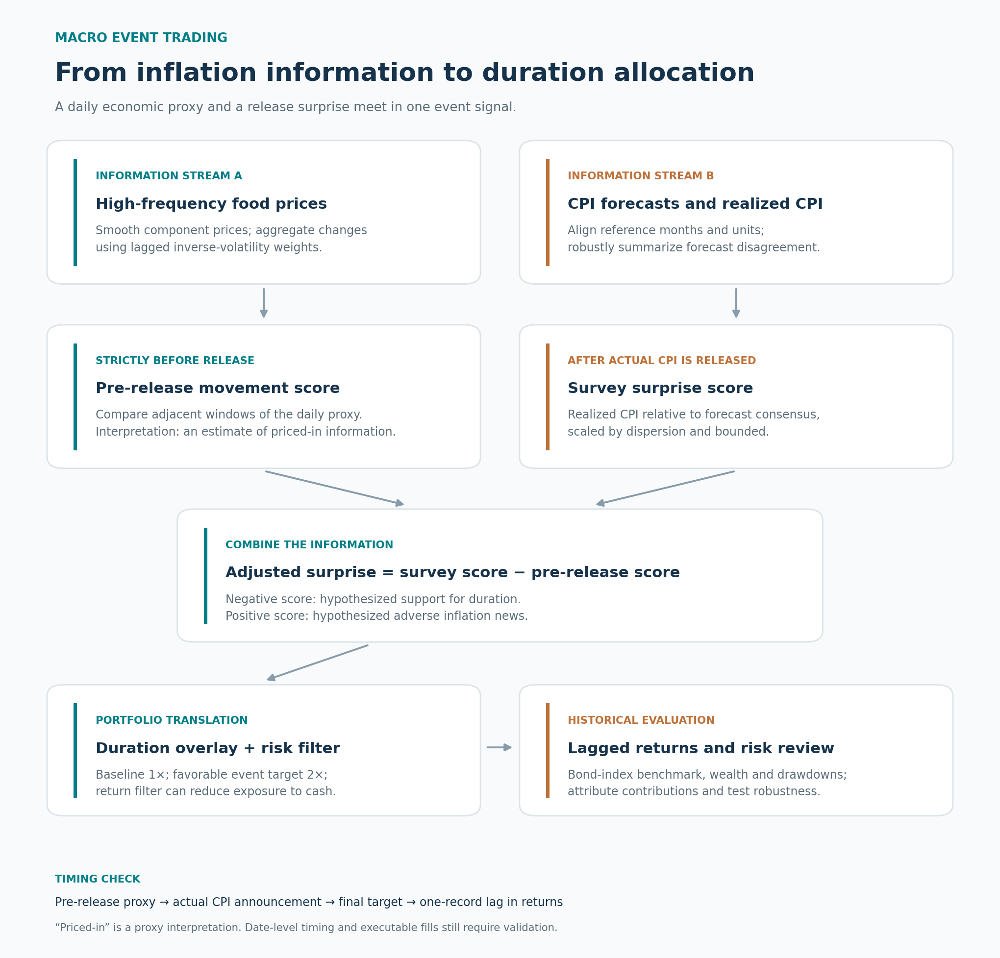
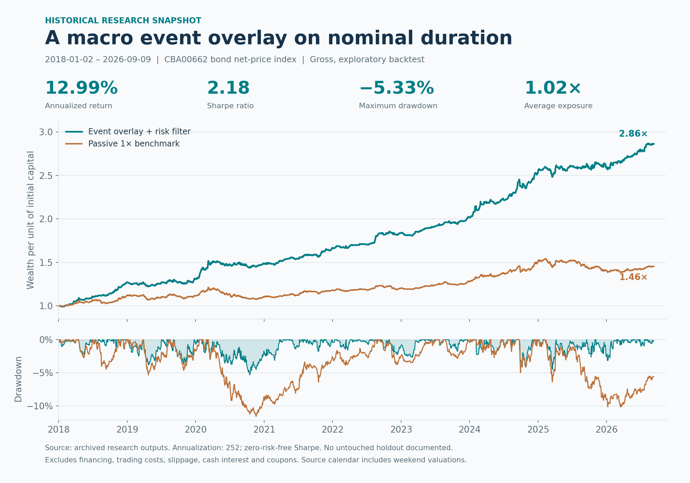

# 中文导读与面试提纲

[英文首页](../README.md) · [方法说明](methodology.md) · [结果与口径](results.md) · [英文面试讲稿](interview_guide.md)

## 一句话介绍

利用高频食品价格构建日频通胀代理，将 CPI 公布值相对卖方预测的意外程度，与公布前代理指标已体现的通胀变化相结合，研究调整后的预期差能否改善债券久期配置。

## 核心经济逻辑

实际 CPI 高于分析师预测，不一定意味着市场完全没有预期。如果公布前相关价格已经上涨，公告中的新增信息可能小于表面的预测误差。研究因此区分两部分：**相对于卖方预测的公布意外**，以及**公布前价格代理已经体现的信息**。

这里的“买方 price-in”是建模解释。食品价格并不直接观测买方持仓、债券市场报价或投资者预期，面试时应称为“公布前信息代理”，并说明还需要独立验证。

## 工作流

| 环节 | 研究内容 |
| --- | --- |
| 日频通胀代理 | 高频食品价格平滑后，按滞后的波动率倒数权重合成日频指数 |
| 卖方公布意外 | 统一 CPI 所属月份和百分比单位，稳健处理预测分布，衡量实际值相对预测中位数的偏离 |
| 公布前信息调整 | 仅使用公布前的代理指标，比较相邻窗口变化，并构造强度评分 |
| 净预期差 | 将卖方意外与公布前信息评分结合；负值对应偏利多久期的研究假设 |
| 配置与风控 | 基础保持多头，利多事件提高仓位，并叠加独立的历史收益过滤规则 |
| 回测评估 | 目标仓位滞后一期计算收益，与同一净价指数的被动持有比较 |

完整信号包含真实 CPI，**公布之后才能形成**。这份展示对应债券净价指数的收盘收益回测，尚未证明能以开盘价或期货合约完成同样的交易。

## 当前结果

实际收益样本为 **2018-01-02 至 2026-09-09**，标的为 **CBA00662 债券净价指数**。

| 指标 | 事件配置与收益过滤组合 | 1 倍被动基准 |
| --- | ---: | ---: |
| 年化复合收益 | 12.99% | 4.45% |
| Sharpe | 2.18 | 0.93 |
| Calmar | 2.44 | 0.38 |
| 最大回撤 | −5.33% | −11.60% |
| 累计收益 | 186.38% | 45.53% |

主版本基础仓位为 1 倍，有利事件提高至 2 倍，持有窗口为 20 条原始估值记录，收益过滤规则可以使仓位降为 0。样本平均实际仓位约为 1.02 倍，但这不等于已经完成风险匹配的业绩比较。

## 面试中应明确的研究边界

- **探索性历史回测：**尚未单独证明独立样本外表现，不把 Sharpe 2.18 称为 OOS 或实盘结果。
- **组合策略表现：**当前结果同时包含宏观事件配置和收益过滤，需要消融实验才能区分贡献。
- **收益为毛收益：**未计融资、交易成本、滑点、现金利息及票息；净价指数也并非可直接交易的资产。
- **日历需要规范：**原始价格保留 60 条周末估值记录，“20 日”准确说是 20 条估值记录。
- **信息时点需要进一步审计：**公布日提交的预测和食品价格的实际可得时间需要时间戳核对；仓位滞后本身不能证明成交假设可实现。
- **统计评分不等于显著性：**平滑后的序列存在自相关，两路评分的变换也不同，需进一步验证尺度、饱和及有效样本量。

## 推荐讲述顺序

先说明“新增信息与预测误差不完全相同”的经济直觉，再展示两路数据如何汇合，接着解释事件配置及滞后计收益，最后给出结果和下一步验证计划。这个顺序更容易让面试官看清你的假设、实现意识和研究判断。

优先补充的验证包括：卖方单独信号、调整后信号、风控单独及组合的消融比较；相同风险水平的基准；冻结参数后的时间顺序留出样本；交易日历、发布时间与真实交易成本验证。这些是后续计划，本仓库未声称已经完成。

公开仓库只包含文字、图表和汇总结果，不包含内部实现代码、notebook、原始数据或逐事件交易信号。
