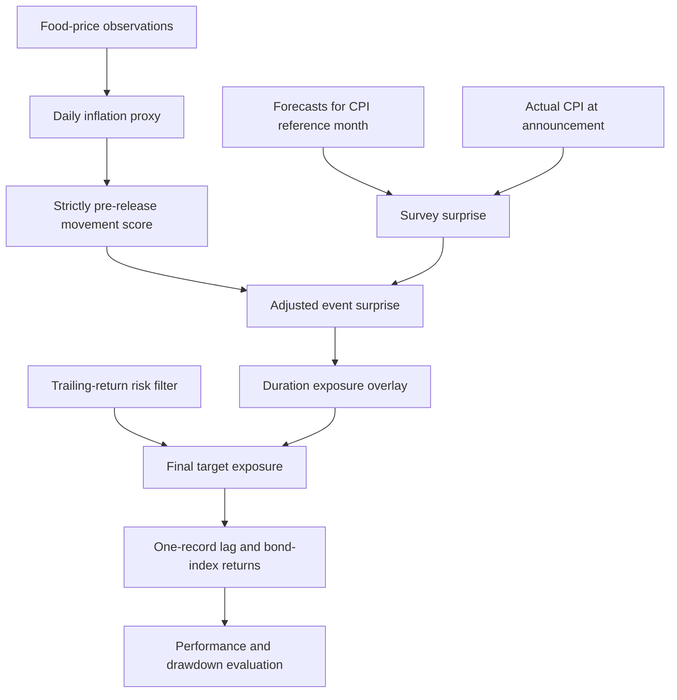

# Research methodology

[Project overview](../README.md) · [Results](results.md) · [Interview guide](interview_guide.md)

## 1. Economic hypothesis

The return response to an economic announcement should depend on how the information compares with expectations. Survey forecasts provide one observable expectation measure, but they are periodic and may not fully incorporate information that arrives between forecast submissions and the release.

This project investigates an adjustment using high-frequency food-price information. The case study is Chinese CPI, with a subsequent allocation overlay on a long-dated government bond net-price index. A relatively negative adjusted inflation surprise is hypothesized to support nominal duration; a relatively positive surprise is hypothesized to be adverse. Growth news, monetary policy, liquidity, and risk premia can offset this channel.

The daily proxy is an **economic inflation proxy**, not an observed investor expectation series. Calling its pre-release movement “price-in” is an interpretation to test, rather than a directly measured fact.

## 2. Two information streams

### A. A daily factor-mimicking inflation proxy

The underlying basket contains high-frequency food-price series with economic links to consumer inflation, including pork, vegetables, eggs, and beef. Prices are smoothed to reduce daily noise. Component changes are aggregated with inverse-volatility weights, and the weights are lagged before aggregation.

The purpose is to represent a slow-moving inflation trend on a daily calendar. This is an economically constructed proxy, rather than a regression portfolio fitted to reproduce the full CPI basket. It does not capture every CPI component and is not a directly tradable portfolio.

Lagged weights prevent the current observation from determining its own allocation weight. They do not resolve every information-timing issue: availability of the underlying price observations must also be checked.

### B. A survey-based announcement surprise

Forecast observations are aligned to the month of CPI they predict. Interval forecasts are converted to midpoints, percentages are stored consistently as decimals, and extreme cross-sectional observations are treated with a robust median-based procedure.

For each reference month, realized CPI is compared with the cleaned forecast median and scaled by forecast dispersion. The score is then transformed to a bounded range to limit the influence of extreme observations.

Forecast dispersion measures disagreement across forecasts. It is not automatically the standard error of the consensus or an estimate of true economic uncertainty. Closely related forecasts and repeated submissions can also reduce the effective amount of independent information.

## 3. Adjusting for pre-release information

Two adjacent windows of the daily inflation proxy are compared using observations strictly before the CPI release. A Welch-style statistic measures the strength of the change and is mapped to a bounded score.

At a conceptual level:

$$Q_T=S_{m(T)}-B_{T^-}$$

| Symbol | Meaning | Availability |
| --- | --- | --- |
| $S_{m(T)}$ | Survey surprise for the CPI reference month published at event $T$ | After actual CPI is released |
| $B_{T^-}$ | Pre-release movement score from the daily inflation proxy | From observations before release |
| $Q_T$ | Adjusted inflation-surprise score | After release |

The construction combines two distinct information sources in an interpretable way. It does not establish that their numerical units are economically equivalent. Different transformations and saturation behavior can make one input dominate the difference; calibration and ablation are necessary follow-up tests.

Because the smoothed proxy is serially dependent, the Welch-style statistic is used as an intensity score. Its textbook independent-sample p-value is not treated as valid evidence of announcement predictability.

## 4. From event score to portfolio exposure

The research configuration maintains a baseline long exposure to the bond index. A favorable inflation event increases the target exposure for a fixed holding window; a new event replaces the preceding event instruction. The published snapshot uses a maximum exposure of 2× and a holding window of 20 source valuation records.

A separate trailing-return quantile filter can temporarily move target exposure to cash. The trailing threshold uses earlier return observations; the current return can trigger a target adjustment, but cannot remove the loss that has already occurred.

Realized historical returns use the preceding valuation record's final target exposure. This return accounting is explicit, but does not yet establish an executable open-price or futures strategy. The bond index is a research benchmark, and financing or an investable implementation must be modeled separately.

## 5. Information timing

Three timing questions are distinct:

1. **Reference month:** which CPI observation did each forecast target?
2. **Information availability:** was each forecast or price observation available before the decision?
3. **Execution:** which tradable price could actually be obtained after all signal inputs became available?

The archived research checks reference-month alignment, strictly pre-release proxy windows, and lagged return accounting. Forecasts are filtered at date resolution, so forecasts submitted on release day still require a timestamp-level audit. A one-record return lag also leaves a release-day closing-fill assumption to validate.

## 6. Evidence status

The complete research history contains 128 matched CPI events across 2016–2026. The displayed backtest has 105 release events within its requested interval and 2,171 return observations. These counts refer to different samples and should not be used interchangeably.

Internal reconciliation confirms that the archived factor index matches the reference output to numerical precision and that the published strategy-return series follows its lagged-exposure definition. Such checks establish calculation consistency; they do not establish forecast power or economic causality.

The next tests are chronological holdouts, signal/risk-filter ablations, matched-risk benchmarks, dependence-aware inference, parameter stability, and executable cost-aware implementation. None is presented here as completed.
