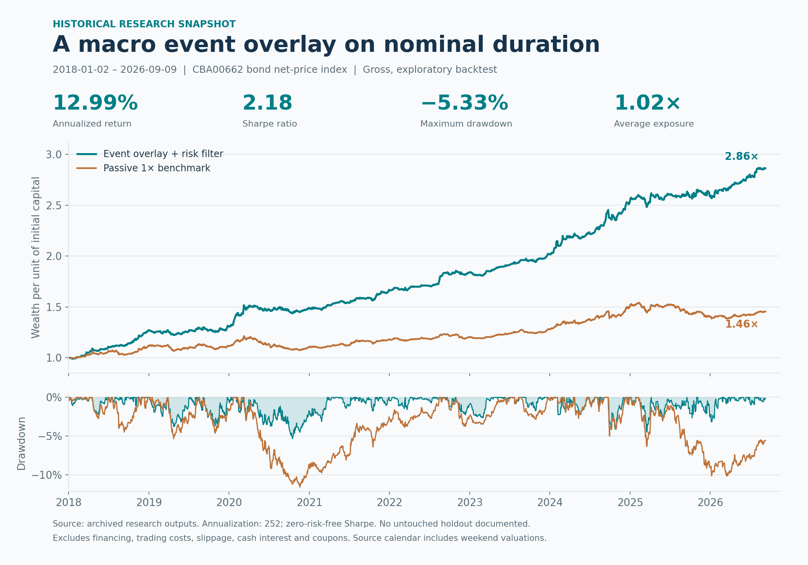
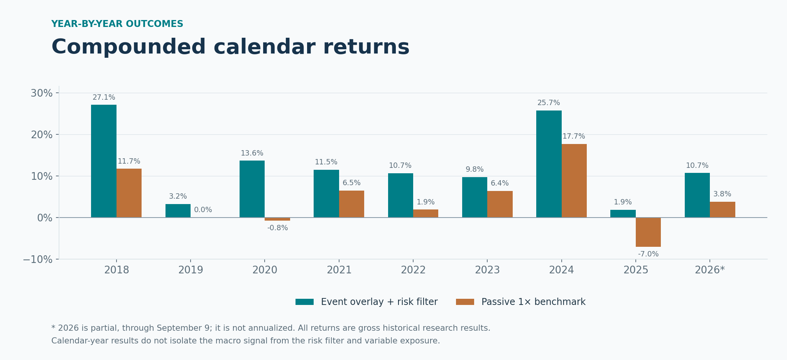

# Results and interpretation

[Project overview](../README.md) · [Methodology](methodology.md)

## Historical snapshot

The figures summarize the archived research configuration without changing its signals, parameters, or return series for this presentation. They are not live performance or a separately established out-of-sample result.

| Metric | Event overlay + risk filter | Passive benchmark |
| --- | ---: | ---: |
| Annualized compounded return | 12.99% | 4.45% |
| Sharpe ratio | 2.183 | 0.934 |
| Calmar ratio | 2.435 | 0.384 |
| Maximum drawdown | −5.33% | −11.60% |
| Cumulative return | 186.38% | 45.53% |
| Ending wealth per unit of initial capital | 2.864 | 1.455 |

[Full-size PNG](../assets/backtest_overview.png) · [Vector figure](../assets/backtest_overview.svg) · [Aggregate CSV](../results/performance_summary.csv)

## Calendar-year returns

| Year | Strategy | Benchmark |
| --- | ---: | ---: |
| 2018 | 27.07% | 11.73% |
| 2019 | 3.25% | 0.03% |
| 2020 | 13.65% | −0.77% |
| 2021 | 11.52% | 6.52% |
| 2022 | 10.66% | 1.91% |
| 2023 | 9.75% | 6.42% |
| 2024 | 25.72% | 17.70% |
| 2025 | 1.87% | −7.04% |
| 2026 through September 9 | 10.73% | 3.82% |

Yearly returns are compounded from the archived return observations. The final row is a partial year and is not annualized. A favorable sequence of yearly returns is descriptive evidence, not a statistical significance test.

[Calendar-return CSV](../results/calendar_returns.csv)

## Backtest conventions

| Item | Reported convention |
| --- | --- |
| Requested sample | 2018-01-01 to 2026-09-09 |
| Actual return observations | 2018-01-02 to 2026-09-09; 2,171 records |
| Instrument | CBA00662 long-dated government bond **net-price** index |
| Benchmark | Unlevered 1× exposure to the same index |
| Exposure | Baseline 1×; favorable events target 2×; return filter can reduce the target to 0× |
| Average realized exposure | Approximately 1.023× |
| Holding window | 20 source valuation records; new events replace prior instructions |
| Return alignment | Preceding valuation record's final target × current close-to-close index return |
| Return filter | Trailing-return quantile rule, applied to target exposure before lagging |
| Metric implementation | Archived QuantStats 0.0.76 output; annualization factor 252; Sharpe uses zero risk-free rate |
| Omitted items | Financing, transaction costs, slippage, cash interest, coupon income |
| Calendar convention | Source records retained, including 60 weekend valuations |
| Event coverage | 105 release events inside the requested backtest interval; 128 matched events in the broader signal history |

The headline annualized return preserves the archived implementation's convention. Irregular valuation records and a fixed annualization factor make calendar normalization a necessary robustness check. Cumulative returns and calendar-year returns are displayed alongside the annualized figure to make this distinction visible.

## What the result supports

Under the reported assumptions, the combined historical configuration produced greater terminal wealth and a smaller maximum drawdown than the passive index. The annual table also shows the outcome in different calendar years, rather than only the full-sample summary.

It is reasonable to present this as an encouraging research result and a basis for further investigation. It does not establish that the adjustment is an independent source of alpha, that the parameters would survive a new sample, or that the headline returns can be achieved after implementation costs.

## What remains unresolved

| Question | Why it matters | Next test |
| --- | --- | --- |
| Does the macro adjustment add value? | The result combines a macro overlay and a return filter | Compare passive, survey-only, adjusted-signal-only, filter-only, and combined configurations |
| Is this a leverage or risk effect? | Exposure varies through time | Compare matched-volatility and matched-duration baselines; report tracking error and information ratio |
| Does performance persist? | No untouched holdout is documented | Freeze the design and evaluate a later chronological sample |
| Is the signal scale stable? | The two scores use different transforms; bounded scores can saturate | Inspect score distributions and test train-only calibration |
| Are event returns independent? | Fixed holding windows may overlap | Use purged splits and event/block resampling; test dependence-aware uncertainty estimates |
| Can it be executed? | Date-level data and an index return model do not specify obtainable fills | Audit publication timestamps and model tradable instruments, next-obtainable fills, financing, and costs |
| Does the calendar matter? | Weekend records alter the meaning of a holding day | Rerun on an exchange calendar and compare the outputs |

## Disclosure boundary

Only summary tables and rendered result figures are included publicly. Raw price histories, analyst submissions, exact event scores, daily positions, research notebooks, and implementation code are not included. The public materials explain the research and its evidence status; they are not an executable replication package.
